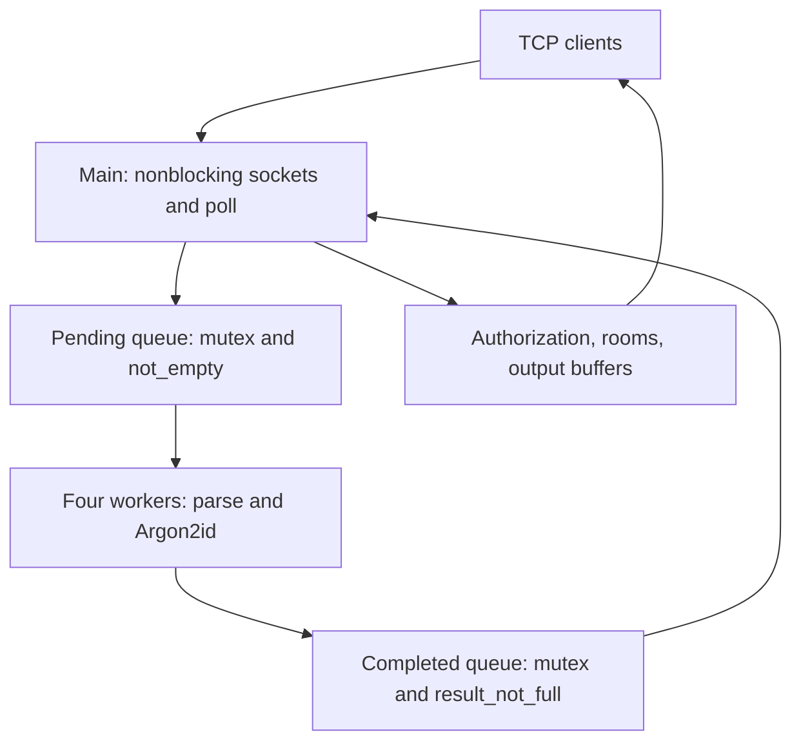

# Architecture and OS concepts

Each client and server is a separate Linux process with its own descriptors.
TCP provides IPC. The server has one network thread plus four persistent workers
sharing an address space. Workers bound thread overhead and hashing concurrency.

Main alone owns sockets, sessions, rooms, rate buckets, and logs. Workers receive
copies, never socket pointers. Authentication records have a separate mutex;
expensive hashing runs outside it. Account snapshot writes serialize under it.

## Function and concept map

| Function/file | Responsibility |
| --- | --- |
| setup_server, server.c | socket/fcntl/setsockopt/bind/listen |
| accept_clients | Bounded accept batch, connection semaphore |
| receive_input | Bounded recv, stream accumulation, byte validation |
| dispatch_one | Framing, rate checks, one in-flight task per client |
| process_completed_tasks | Result consumption, stale-ID rejection |
| apply_result | Authorization, server-controlled identity, routing |
| queue_message / flush_output | Partial writes, EAGAIN, bounded output, POLLOUT |
| remove_client | Descriptor/session cleanup, exactly one semaphore release |
| worker_function, thread_pool.c | Producer-consumer queues and condition loops |
| register_user / login_user, auth.c | Locked records, independent Argon2id work |
| rate_allow, security.c | Monotonic token bucket |
| chat_create, chat.c | Unique bounded room registry |
| logger_event, logger.c | Main-thread safe bounded logs |
| parse_command, protocol.c | Shared bounded command grammar |
| connect_to_server, client.c | Nonblocking connect/readiness/error handling |

## Synchronization invariants

Each registered connection consumes one semaphore permit and returns it once.
Pool counters, queue indices, and lifecycle flags are mutex-protected; condition
waits use predicate loops for spurious wakeups.

Unfinished = pending + processing/publishing + unconsumed results. Workers finishing
callbacks do not decrement unfinished; consumption/discard does. Active workers
counts executing callbacks, not publishers waiting for result capacity. all_done
is signalled at zero; main uses nonblocking snapshots instead of waiting there.
Draining results signals result_not_full and prevents a shutdown join deadlock.

One task per connection preserves login-before-message order; different clients
remain concurrent. Connection IDs increase independently of reused slots/fds.
IDs never wrap; accepts stop on exhaustion. Results with no matching ID are discarded.

## Networking and fairness

TCP is a byte stream, not message packets. Per-client input accumulates chunks
until LF. Only complete lines up to 1023 bytes are submitted. Buffers hold 8192
bytes; full input disables POLLIN. Each iteration accepts at most 16 clients,
receives at most 4096 bytes per client, submits at most one task per client, and
sends at most 4096 bytes per client. Main checks results before polling; the 50 ms
poll timeout ensures completed work is noticed without new network events.

Output offsets advance only by actual bytes sent. EAGAIN retains data; POLLOUT
is enabled only with pending bytes. MSG_NOSIGNAL prevents SIGPIPE termination.
Overflow removes the slow recipient, never blocking a broadcast globally.
Write-side EOF drains buffered complete requests, then closes; incomplete tails
are rejected. Full hangup/reset removes the session. Room membership is stored
in the client record, so removal automatically clears it.

## Signals and cleanup

Signal handlers only set volatile sig_atomic_t. Main closes the listener, stops
submission, discards unsubmitted input, drains results/output, and notifies clients.
There is a five-second main drain window and two-second closing-output deadlines.
Then sockets close; pool destroy wakes consumers and full-result publishers,
finishes accepted work, discards unconsumed results, and joins all workers.
Auth storage is freed after workers join. Hashes are not forcibly cancelled, so
slow VMs can take longer than five seconds to exit. Accepted registrations can
persist after their client disconnects.

## Headers

sys/socket.h supplies socket APIs; netinet/in.h IPv4 structures; arpa/inet.h
address and byte-order conversion; fcntl.h fd flags and secure file opens;
unistd.h read/write/close; poll.h readiness; signal.h signals; semaphore.h
permits; pthread.h threads/mutexes/conditions; time.h clocks; sys/stat.h file
permissions/types; sys/file.h flock; termios.h terminal echo; sodium.h password
hashing and secure clearing. Standard C headers provide bounded strings,
formatting, error codes, size types, and fixed-width integers.
